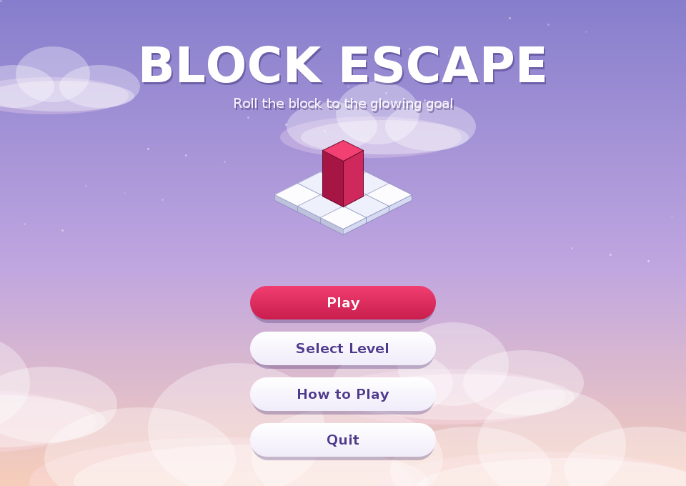
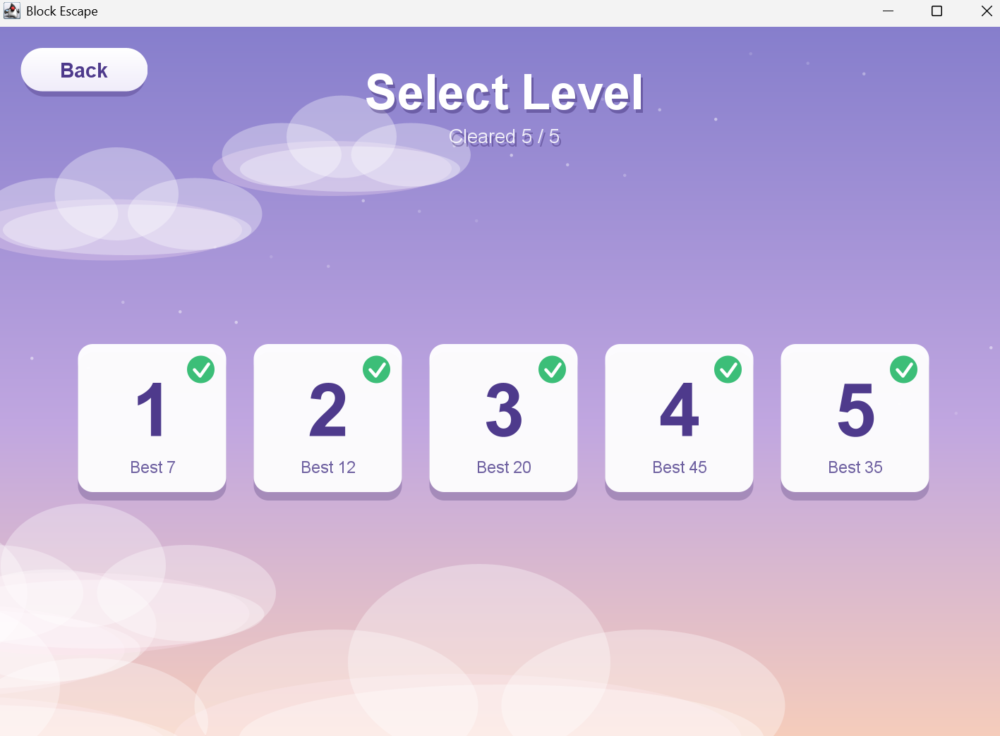
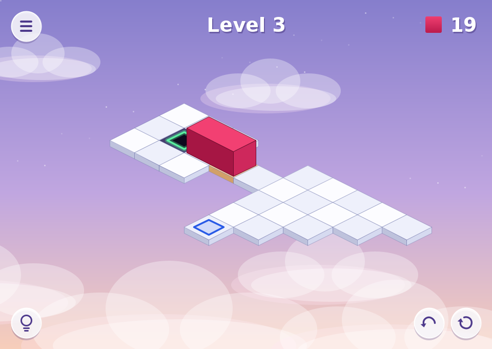
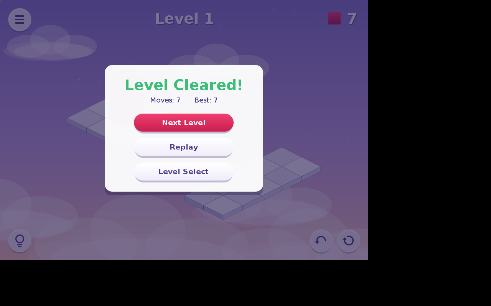

# Block Escape – A Java Puzzle Game

A Java-based 3D-inspired puzzle game built using Java Swing. Navigate a rectangular block through challenging levels, avoid holes, activate switches, and reach the goal!

##  About the Game

Block Escape is a logic-based puzzle game where players control a rectangular block across a grid-based board.

The objective is to guide the block from its starting position to the goal while navigating obstacles, holes, and special tiles.

The game features five progressively challenging levels, with each level introducing more complex movement and board layouts.

##  Features

- **5 Playable Levels:** Increasing difficulty and unique layouts.
- **Block Movement:** Control the block using keyboard inputs.
- **Multiple Orientations:** The block can stand upright or lie horizontally/vertically.
- **Obstacles and Holes:** Navigate carefully to avoid falling.
- **Switches and Bridges:** Activate switches to make blocked tiles accessible.
- **Undo:** Reverse previous moves.
- **Restart:** Reset the current level.
- **Move Counter:** Track the number of moves.
- **Level Progression:** Unlock and complete subsequent levels.
- **Graphical Interface:** Built with Java Swing.

##  Technologies Used

- Java
- Java Swing
- Object-Oriented Programming
- Breadth-First Search (BFS) for level solvability verification

##  Screenshots

### Home Screen


### Level Selection


### Gameplay


### Victory Screen


##  Controls

| Key | Action |
|---|---|
| Arrow Up | Move up |
| Arrow Down | Move down |
| Arrow Left | Move left |
| Arrow Right | Move right |
| W / A / S / D | Alternative movement controls |

Additional actions such as Undo and Restart are available through the game interface.

##  Getting Started

### Prerequisites

- Java Development Kit (JDK)
- Java compiler (`javac`)
- Java runtime (`java`)

### Installation

1. Clone the repository:

   ```bash
   git clone YOUR_GITHUB_REPOSITORY_URL
   ```

2. Navigate to the project folder:

   ```bash
   cd blockescape
   ```

3. Compile the source files:

   ```bash
   javac -d out src/blockescape/*.java
   ```

4. Run the game:

   ```bash
   java -cp out blockescape.GuiMain
   ```

##  Testing

The project includes a BFS-based level verification program in:

`test/blockescape/LevelCheck.java`

It checks whether all five levels are solvable and replays the generated solutions through the game controller.

To compile and run the tests:

```bash
javac -d out src/blockescape/*.java test/blockescape/LevelCheck.java
java -cp out blockescape.LevelCheck
```

Expected result:

```text
ALL LEVELS PASS
```

##  Project Structure

```text
blockescape/
│
├── src/
│   └── blockescape/
│       ├── GuiMain.java
│       ├── GameController.java
│       ├── GamePanel.java
│       ├── GameWindow.java
│       ├── LevelManager.java
│       └── Other game classes...
│
├── test/
│   └── blockescape/
│       └── LevelCheck.java
│
├── screenshots/
├── .gitignore
└── README.md
```
## Team Contributions

### Person 1 - 

 Board and Tile System

- **Board Creation:** Implemented the `Board` class using a two-dimensional `Tile` array to represent the game grid.
- **Tile Management:** Added functionality to initialize, access, update, and display tiles on the board.
- **Tile Classes:** Developed different tile types, including `NormalTile`, `HoleTile`, `GoalTile`, `SwitchTile`, and `VoidTile`.
- **Tile Properties:** Implemented tile-specific symbols and behaviours, including safety, goal, switch, and void identification.
- **Object-Oriented Design:** Applied abstraction, encapsulation, inheritance, and polymorphism through the abstract `Tile` class and its subclasses.
- **Boundary Handling:** Added board boundary checks and validation to prevent invalid tile access and null tile assignments.
- **Integration Support:** Structured the board and tile components for use by the other game systems.

### Person 6 – Level Design, Integration & Testing

- **Level 5 Development:** Designed and added the fifth playable level with challenging holes, obstacles and orientation-based movement, increasing the game's difficulty without introducing new mechanics.
- **Level Solvability Verification:** Tested all five levels using the BFS-based `LevelCheck` program to verify that each level has a valid solution.
- **Controller Validation:** Verified that the BFS-generated solutions could be successfully replayed through the game controller.
- **Gameplay Testing:** Performed end-to-end testing of movement, block orientations, switches, bridge activation, undo, restart, winning and falling mechanics.
- **Level Progression Testing:** Verified level unlocking and progression from Level 1 through Level 5.
- **Code Cleanup & Integration:** Removed obsolete files and temporary debug code, addressed unused code warnings, and verified successful compilation and execution.
- **Documentation & GitHub:** Prepared and updated the README, organized project screenshots, configured Git, and published the project repository on GitHub.

##  Future Improvements

- Persistent player progress and saved best scores.
- In-game hint system.
- Additional puzzle levels.
- Enhanced animations and visual effects.

##  Project Status

Completed: Five playable levels with successful BFS solvability verification and controller replay testing.

---

**Block Escape – Think Strategically. Move Carefully. Reach the Goal!**
